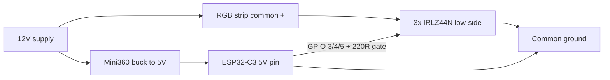

# ESP32-C3 BLE RGB LED Controller
 
Open-source firmware that turns an **ESP32-C3** into a **Bluetooth LE** controller for an analog (non-addressable) **common-anode RGB** LED strip. No WiFi, no router, no cloud, no app account — connect over BLE while you're in range and set a color.
 
Built as a from-scratch replacement for a dead "610+MIC+IR"-style cheap analog RGB controller.
 

 
---
 
## Features
 
- **BLE-only control** — pair in range, nothing to configure on your network
- **Solid color** + **master brightness**
- Built-in effects: **rainbow cycle** and **breathe**
- Hardware PWM on three channels via the ESP32-C3 LEDC peripheral
- Drives a 12 V common-anode strip through logic-level N-MOSFETs (low-side switching)
- ~180 lines, **no external libraries** — uses the BLE stack bundled with the ESP32 Arduino core

**Not included (on purpose):** microphone/music reactivity, IR remote, WiFi. See [Extending](#extending) if you want them back.
 
---
 
## Hardware
 
| Qty | Part | Notes |
| --- | --- | --- |
| 1 | ESP32-C3 dev board | e.g. "C3 Super Mini" |
| 3 | IRLZ44N (or any logic-level N-MOSFET) | one per color, low-side switch |
| 3 | 220 Ω resistor | gate series resistor |
| 3 | 10 kΩ resistor | gate pulldown (gate → GND) |
| 1 | Mini360 / MP2307 buck converter | set output to 5 V |
| 1 | 12 V DC power supply | sized for your strip |
| 1 | Common-anode analog RGB strip | 4 wires: `+`, `R`, `G`, `B` |
 
> The IRLZ44N is logic-level but its on-resistance is specified at 5 V gate drive, not 3.3 V. At typical strip currents (~1–3 A/channel) it still runs cool. For long or high-current strips, add a small heatsink or use a proper gate driver.
 
---
 
## Wiring
 
Power splits from the 12 V supply: one leg to the strip's common `+`, one leg to the buck converter, which steps down to 5 V for the ESP32-C3.
 

 
Each color is one MOSFET as a **low-side switch**: strip color wire → MOSFET **drain**, **source** → ground, **gate** → ESP32 GPIO through a 220 Ω resistor, with a 10 kΩ pulldown from gate to ground so the strip stays off during boot/flash.
 
**GPIO map:**
 
| Signal | ESP32-C3 GPIO |
| --- | --- |
| Red | 3 |
| Green | 4 |
| Blue | 5 |
 
These avoid the strapping pins (2/8/9), the USB pins (18/19), and the UART pins (20/21). Change them at the top of the sketch if needed.
 
**Power the ESP32 from the buck's 5 V into the board's 5V/VBUS pin** (not 3V3) so the onboard regulator makes the 3.3 V. Set the Mini360 to 5.0 V with a multimeter *before* connecting the board.
 
**One common ground** ties together the PSU minus, the buck ground, the ESP32 ground, and all three MOSFET sources. Missing this is the #1 reason nothing switches.
 
> ⚠️ **The metal tab on a TO-220 MOSFET is the Drain.** If the three tabs touch each other (easy to do on a breadboard), all three color channels are shorted together and *any* single color command lights the whole strip white. Keep the tabs apart. See [Troubleshooting](#troubleshooting).
 
---
 
## BLE protocol
 
- **Device name:** `ESP32C3-RGB`
- **Service UUID:** `9a1e5b00-0001-4a2b-8c00-1a2b3c4d5e6f`

| Characteristic | UUID | Write | Meaning |
| --- | --- | --- | --- |
| Color | `9a1e5b00-0002-4a2b-8c00-1a2b3c4d5e6f` | 3 bytes: `RR GG BB` | set solid color (switches to solid mode) |
| Brightness | `9a1e5b00-0003-4a2b-8c00-1a2b3c4d5e6f` | 1 byte: `00`–`FF` | master brightness |
| Mode | `9a1e5b00-0004-4a2b-8c00-1a2b3c4d5e6f` | 1–2 bytes: `mode [, speed]` | select effect |
 
**Modes:** `0` = solid, `1` = rainbow, `2` = breathe. **Speed:** `01` (slow) … `FF` (fast).
 
All three characteristics are also readable, so a client can poll the current state.
 
---
 
## Build & flash
 
1. Install the **ESP32 Arduino core v3.0 or newer** (Boards Manager → "esp32" by Espressif). The firmware uses the v3 LEDC API (`ledcAttach` / `ledcWrite(pin, duty)`).
2. Open `esp32c3_ble_rgb/esp32c3_ble_rgb.ino`.
3. Select your ESP32-C3 board under **Tools → Board**.
4. Upload. No extra libraries to install — the BLE stack ships with the core.

If you hit a **"sketch too big"** error, set **Tools → Partition Scheme → "Minimal SPIFFS (1.9MB APP)"**.
 
---
 
## Usage
 
Grab a generic BLE app (**nRF Connect**, LightBlue, etc.):
 
1. Scan and connect to `ESP32C3-RGB`.
2. Open the service and write raw bytes to the characteristics:
   - **Color** → `FF0000` (red), `00FF00` (green), `0000FF` (blue), `FFFF00` (yellow)
   - **Brightness** → `80` (half)
   - **Mode** → `01 80` (rainbow, medium speed), `02 40` (slow breathe), `00` (back to solid)

> **iOS note:** Web Bluetooth isn't supported in iOS browsers, so a browser-based controller won't work on iPhone — use a native BLE app like nRF Connect instead. Android Chrome supports Web Bluetooth if you want to build a web UI.
 
---
 
## Extending
 
- **RGBW:** add a `PIN_W`, give it its own `ledcAttach`, and extend the color write to 4 bytes.
- **More effects:** each mode is an `else if` branch in `loop()` that calls `writeRGB(...)`. Copy the rainbow/breathe pattern.
- **Power on/off:** add a characteristic (or reuse brightness `00`) to blank the output.

---
 
## Troubleshooting
 
| Symptom | Likely cause | Fix |
| --- | --- | --- |
| Any single color lights the **whole strip white** | The three MOSFET metal tabs (= Drains) are touching and shorting the channels together | Space the MOSFETs apart; don't share a heatsink without insulating washers/pads |
| One color works, the others look wrong | Strip color wires or gate wiring swapped on those channels | Compare the broken channels lead-for-lead against the working one |
| `invalid conversion from 'volatile uint8_t*'...` | Passing a `volatile` pointer to `setValue()` | Already handled in the sketch (copies to a local first) |
| Compile error on a BLE callback line | Core version uses the 2-argument callback form | Add `, esp_ble_gatts_cb_param_t *param` to the `onWrite`/`onConnect`/`onDisconnect` signatures |
| "Sketch too big" | Default partition too small for BLE | Partition Scheme → "Minimal SPIFFS (1.9MB APP)" |
| Can't see the device / drops out | BLE range (~10 m) or already connected elsewhere | Move closer; disconnect other clients |
 
---
 
## License
 
[MIT](LICENSE) © 2026 James Ankney
 
